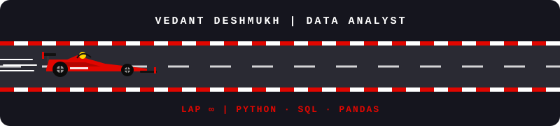

  

  

  
  
  

Based in Mumbai. Like an F1 team reading telemetry, I clean data, explore it, and find the insight a decision depends on. 
<b>Open to Data Analyst roles and internships.</b>

---

## 🏁 Featured Projects

| Project | Key finding | Tools |
|---|---|---|
| [**Superstore Sales & Profitability Analysis**](https://github.com/vedant11460/superstore-sales-analysis) | Orders discounted above 20% drove about 135K in losses; Tables lost 17.7K despite 207K in sales | Python, Pandas, NumPy, Matplotlib |
| [**Superstore SQL Business Analysis**](https://github.com/vedant11460/superstore_sql_analysis) | Furniture earns a 2.5% margin vs 17.4% for Technology; 7 queries using CTEs and window functions | SQL (SQLite), Python |

---

## 🛠 Skills

  
  
  
  
  
  
  
  
  

---

## 🔧 Currently in the Garage

- Python backend development
- Data structures and algorithms in Python
- Statistics for data analysis

---

## 📊 Race Stats

  
  

  

  

## 🐍 Contribution Grid

  

